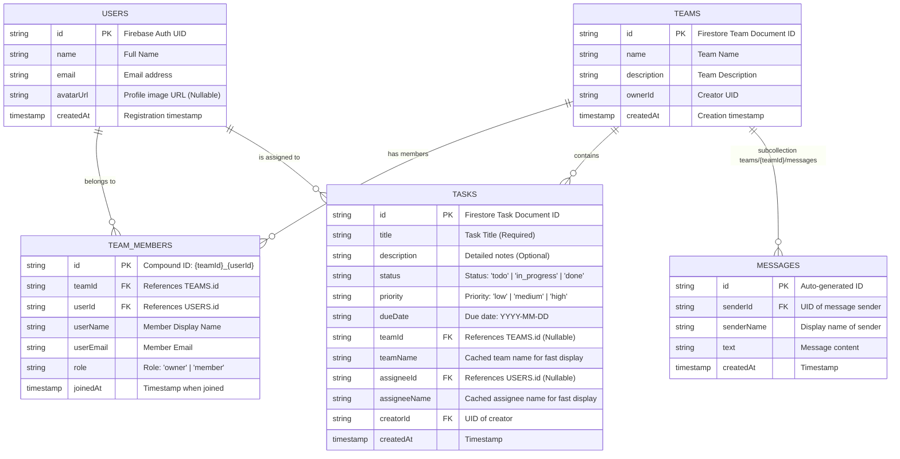

# TaskAura PRO – Task Management & Team Collaboration Mobile App (Practical Exam 2)

> **Course**: MMA301 – Mobile Programming  
> **Topic**: Practical Exam 2: Firebase Authentication, Real Team Management, Task-Team-Assignee Linking, Real-time Team Chat & Cloud Firestore Security Rules

[-success?style=for-the-badge&logo=android)](https://expo.dev/artifacts/eas/xNhGLgDStTZkIj2rfb8PtnWNXKuC1JF2CbWNRTql03w.apk)
[](https://expo.dev/accounts/kimchiha/projects/taskaura/builds/0021a039-d9e3-4d35-89e6-013800399b58)

### 📲 Cài đặt ứng dụng trên Android:
- **Tải trực tiếp file APK**: [**Download TaskAura_PRO.apk (Direct Link)**](https://expo.dev/artifacts/eas/xNhGLgDStTZkIj2rfb8PtnWNXKuC1JF2CbWNRTql03w.apk)
- **Trang quản lý Build & QR code**: [Expo EAS Build Dashboard](https://expo.dev/accounts/kimchiha/projects/taskaura/builds/0021a039-d9e3-4d35-89e6-013800399b58)

---

## 📱 Project Overview

**TaskAura PRO** is an enterprise-grade cross-platform mobile application built with **React Native** and **Expo (TypeScript)**. It retains all core Task CRUD operations from Practical Exam 1 while extending the architecture to support:

1. **Firebase Authentication (Email & Password)** with persistent session across app restarts.
2. **User Profiles in Cloud Firestore** (`users` collection).
3. **Protected Navigation**: Split into `AuthStack` (Login / Sign Up) and `AppStack` (Main Tabs + Team Detail + Real-time Team Chat).
4. **Team Management**: Real-time team creation, joining via Team Code or public directory, and team member management (`teams` and `teamMembers`).
5. **Task-Team-Assignee Linking**: Dynamic team and assignee pickers in task creation/editing, team tag and assignee name display on task cards, and permission-guarded task visibility.
6. **Real-time Team Chat**: Subcollection `teams/{teamId}/messages` with live `onSnapshot` streaming, differentiated chat bubbles, and responsive keyboard input.
7. **Firestore Security Rules**: Ready-to-paste `firestore.rules` enforcing authenticated access.

---

## 🗄️ Firestore Data Model & ERD



---

## 🚀 Getting Started

### 1. Prerequisites

- [Node.js](https://nodejs.org/) (v18 or v20+)
- [Expo Go](https://expo.dev/go) on iOS / Android or Emulator / Simulator

### 2. Installation

```bash
git clone <your-repository-url>
cd MMA301_ASS
npm install
```

### 3. Firebase Configuration

The project is already pre-configured with project credentials in `.env`.
If you wish to use your own Firebase project:

1. Enable **Authentication** -> **Email/Password**.
2. Enable **Cloud Firestore Database**.
3. Copy your Web App config into `.env`:
   ```env
   EXPO_PUBLIC_FIREBASE_API_KEY=AIzaSy...
   EXPO_PUBLIC_FIREBASE_AUTH_DOMAIN=...firebaseapp.com
   EXPO_PUBLIC_FIREBASE_PROJECT_ID=...
   EXPO_PUBLIC_FIREBASE_STORAGE_BUCKET=...
   EXPO_PUBLIC_FIREBASE_MESSAGING_SENDER_ID=...
   EXPO_PUBLIC_FIREBASE_APP_ID=...
   EXPO_PUBLIC_FIREBASE_MEASUREMENT_ID=...
   ```
4. Paste the content of `firestore.rules` into Firebase Console -> Firestore Database -> Rules.

### 4. Running the App

```bash
# Start development server
npm start

# Run on Android
npm run android

# Run on iOS
npm run ios

# Run in Web Browser
npm run web

# Check types
npm run type-check

# Run linter
npm run lint
```

---

## 🛠️ Project Structure

```
MMA301_ASS/
├── firestore.rules              # Production-ready Firestore Security Rules
├── App.tsx                      # Root component wrapped with AuthProvider & SafeAreaProvider
├── src/
│   ├── components/              # Reusable UI components
│   │   ├── Header.tsx           # Header with user badge and cloud status
│   │   ├── TaskCard.tsx         # Task item with team tag, assignee tag, and actions
│   │   └── TaskFormModal.tsx    # Create/Edit Task modal with Team & Assignee pickers
│   ├── constants/
│   │   └── theme.ts             # Soft periwinkle & violet design theme tokens
│   ├── contexts/
│   │   └── AuthContext.tsx      # Global auth state & onAuthStateChanged persistence
│   ├── hooks/
│   │   └── useTasks.ts          # Task state management and synchronization
│   ├── navigation/
│   │   └── AppNavigator.tsx     # AuthStack vs AppStack (Tabs, TeamDetail, TeamChat)
│   ├── screens/
│   │   ├── HomeScreen.tsx       # Main Tasks list with team-permission filtering
│   │   ├── LoginScreen.tsx      # Sign in with validation and error translations
│   │   ├── RegisterScreen.tsx   # Sign up and user doc creation in Firestore
│   │   ├── ProfileScreen.tsx    # User profile and working Logout action
│   │   ├── TeamsScreen.tsx      # User teams, Create Team modal, Join Team modal
│   │   ├── TeamDetailScreen.tsx # Team info, members, team tasks, and chat entry
│   │   └── TeamChatScreen.tsx   # Real-time Team Chat with subcollection listener
│   ├── services/
│   │   ├── authService.ts       # Auth methods and error code formatting
│   │   ├── chatService.ts       # Subcollection messaging & real-time streaming
│   │   ├── firebase.ts          # Firebase App, Firestore, and Auth initialization
│   │   ├── taskService.ts       # Task CRUD operations & queries
│   │   └── teamService.ts       # Team creation, membership, and querying
│   └── types/
│       ├── auth.ts              # UserProfile and AuthContextType
│       ├── task.ts              # Task, CreateTaskInput, UpdateTaskInput
│       └── team.ts              # Team, TeamMember, ChatMessage
├── package.json
├── tsconfig.json
└── README.md
```

---

## 📋 Features Checklist (Practical Exam 2)

- [x] **Firebase Authentication**:
  - [x] Email & Password sign-up and sign-in.
  - [x] Automatic user profile persistence in Firestore `users/{uid}`.
  - [x] Session persistence across restarts using `onAuthStateChanged` and `AsyncStorage`.
  - [x] User-friendly error messaging for invalid credentials, duplicate emails, weak passwords.
  - [x] Profile screen with active user details and working logout button.
- [x] **Teams Feature**:
  - [x] Firestore structure with `teams` and `teamMembers`.
  - [x] Real-time list of teams the user belongs to.
  - [x] Modal to create a new team (creator automatically assigned 'owner' role).
  - [x] Join team by Team ID / Code, plus directory of discoverable teams.
  - [x] Team Detail Screen displaying team info, members, team tasks, and Team Chat button.
- [x] **Task-Team-Assignee Linking**:
  - [x] Team Picker dropdown selecting from user's teams (or personal/no team).
  - [x] Dynamic Assignee Picker loaded in real-time from members of the selected team.
  - [x] Storage of `teamId`, `teamName`, `assigneeId`, `assigneeName`, `creatorId` in task documents.
  - [x] Assignee name and Team tag clearly displayed on task cards.
  - [x] Task permissions: User can only view and manage tasks for teams they are a member of (or personal tasks).
- [x] **Real-time Team Chat**:
  - [x] Dedicated Chat screen per team (`TeamChatScreen`).
  - [x] Subcollection `teams/{teamId}/messages` with `{ senderId, senderName, text, createdAt }`.
  - [x] Real-time streaming via `onSnapshot` ordered by `createdAt asc`.
  - [x] Differentiated bubble styling (Current user: right-aligned gradient bubble; Other users: left-aligned bubble with avatar & name).
  - [x] Fixed bottom input bar with Send button and automatic scrolling to bottom.
- [x] **Firestore Security Rules**:
  - [x] `firestore.rules` provided requiring `request.auth != null` for `users`, `teams`, `teamMembers`, `tasks`, and subcollection `messages`.
