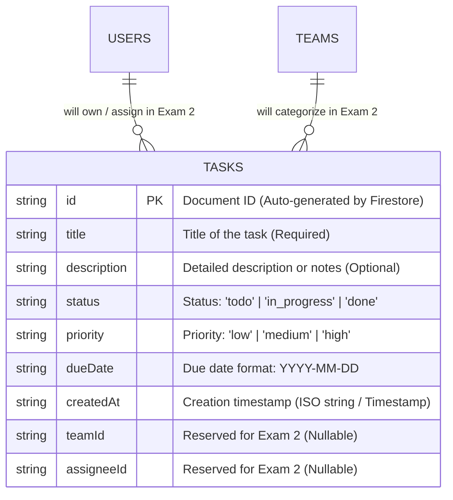

# TaskAura PRO – Task Management Mobile App (Practical Exam 1)

> **Course**: MMA301 – Mobile Programming  
> **Topic**: Technical Foundation of Task Management App: React Native (Expo), Firebase Firestore Setup & Real-time CRUD (No Authentication)

---

## 📱 Project Overview

**TaskAura PRO** is a modern, responsive cross-platform mobile application built with **React Native** and **Expo (TypeScript)**, connected directly to **Google Cloud Firestore** for seamless, real-time task management. 

### Key Highlights
- **Architecture**: Modular structure separating screens, components, services, types, and hooks.
- **Data Layer**: Direct integration with Firebase SDK v11 (Cloud Firestore) supporting real-time listeners (`onSnapshot`) and resilient fallback mechanisms.
- **Navigation**: Clean Bottom Tabs Navigation (Home, Teams, Profile) with vector icons.
- **Responsive Design**: Fluid layout automatically optimized for both smartphones and tablets.
- **CI/CD Ready**: Automated GitHub Actions CI workflow for linting and type-checking.

---

## 🗄️ Firestore Data Model & Schema (ERD)

The application stores tasks in the `tasks` collection within Google Cloud Firestore.

### Entity Relationship Diagram (ERD)



### Field Definitions

| Field Name | Type | Required | Description |
| :--- | :--- | :--- | :--- |
| `id` | `string` | Yes | Unique Firestore Document ID (auto-generated) |
| `title` | `string` | Yes | Task title (validated: non-empty, trimmed) |
| `description` | `string` | No | Task notes or acceptance criteria |
| `status` | `string` | Yes | `'todo'` \| `'in_progress'` \| `'done'` |
| `priority` | `string` | Yes | `'low'` \| `'medium'` \| `'high'` |
| `dueDate` | `string` | Yes | Target completion date (`YYYY-MM-DD`) |
| `createdAt` | `string` \| `Timestamp` | Yes | Document creation time |
| `teamId` | `string` \| `null` | No | Null for Exam 1, utilized in Exam 2 |
| `assigneeId` | `string` \| `null` | No | Null for Exam 1, utilized in Exam 2 |

---

## 🚀 Getting Started

### 1. Prerequisites
- [Node.js](https://nodejs.org/) (v18 or higher recommended)
- [Expo Go](https://expo.dev/go) app installed on your physical mobile device, OR an Android/iOS emulator.

### 2. Installation

Clone the repository and install dependencies:

```bash
git clone <your-repository-url>
cd MMA301_ASS
npm install
```

### 3. Firebase Configuration

1. Copy `.env.example` to `.env`:
   ```bash
   cp .env.example .env
   ```
2. In the [Firebase Console](https://console.firebase.google.com/):
   - Create a project (e.g. `taskflow-exam1`).
   - Enable **Cloud Firestore** in **Test Mode** (allowing read/write for development).
   - Register a Web App and copy the config keys into your `.env` file:
     ```env
     EXPO_PUBLIC_FIREBASE_API_KEY=AIzaSy...
     EXPO_PUBLIC_FIREBASE_AUTH_DOMAIN=your-project.firebaseapp.com
     EXPO_PUBLIC_FIREBASE_PROJECT_ID=your-project
     EXPO_PUBLIC_FIREBASE_STORAGE_BUCKET=your-project.appspot.com
     EXPO_PUBLIC_FIREBASE_MESSAGING_SENDER_ID=...
     EXPO_PUBLIC_FIREBASE_APP_ID=...
     ```
   *(Note: The app comes with resilient demonstration data so all features work immediately out-of-the-box even before adding credentials!)*

### 4. Running the Application

```bash
# Start Expo development server
npm start

# Run directly on web browser
npm run web

# Run on Android emulator / device
npm run android

# Run on iOS simulator
npm run ios
```

---

## 🛠️ Project Structure

```
MMA301_ASS/
├── .github/
│   └── workflows/
│       └── ci.yml               # GitHub Actions CI workflow
├── src/
│   ├── components/              # Reusable UI components
│   │   ├── Header.tsx           # Application header with connection indicator
│   │   ├── TaskCard.tsx         # Task item card with actions & badges
│   │   └── TaskFormModal.tsx    # Modal for creating & editing tasks
│   ├── constants/
│   │   └── theme.ts             # Harmonious color palette & spacing
│   ├── hooks/
│   │   └── useTasks.ts          # State management & real-time synchronization
│   ├── navigation/
│   │   └── AppNavigator.tsx     # Bottom Tabs (Home, Teams, Profile)
│   ├── screens/
│   │   ├── HomeScreen.tsx       # Main Task CRUD & filtering screen
│   │   ├── TeamsScreen.tsx      # Teams placeholder screen (Exam 2)
│   │   └── ProfileScreen.tsx    # Profile placeholder screen (Exam 2)
│   ├── services/
│   │   ├── firebase.ts          # Firebase SDK initialization
│   │   └── taskService.ts       # Firestore CRUD & onSnapshot listener
│   └── types/
│       └── task.ts              # TypeScript interfaces and models
├── .env.example                 # Example environment variables
├── firebaseConfig.example.ts    # Example config file
├── App.tsx                      # Application root entry
├── package.json
├── tsconfig.json
└── README.md
```

---

## ✨ Features Implemented

- [x] **Project Scaffolding**: Expo TypeScript with clean modular architecture.
- [x] **ESLint & Prettier**: Configured for consistent code style.
- [x] **Navigation**: Bottom Tab Navigator (`Home`, `Teams`, `Profile`).
- [x] **Real-time Firestore CRUD**:
  - **Create**: Add new task with validated title, description, status, priority, due date.
  - **Read**: Live real-time updates via `onSnapshot` subscription.
  - **Update**: Edit task attributes seamlessly in an intuitive modal.
  - **Delete**: Remove task with interactive confirmation alert.
- [x] **Bonus Features**:
  - **Client-Side Validation**: Immediate feedback on required fields.
  - **Status Filter**: Fast filtering by `All`, `To Do`, `In Progress`, `Done` with live task counts.
  - **Search Bar**: Real-time keyword filter across titles and descriptions.
  - **Pull to Refresh**: `RefreshControl` support for manual data reload.
  - **CI Workflow**: Automated GitHub Actions checking types and formatting on pushes.
  - **Responsive Layout**: Adapts gracefully to tablet and mobile screens.
