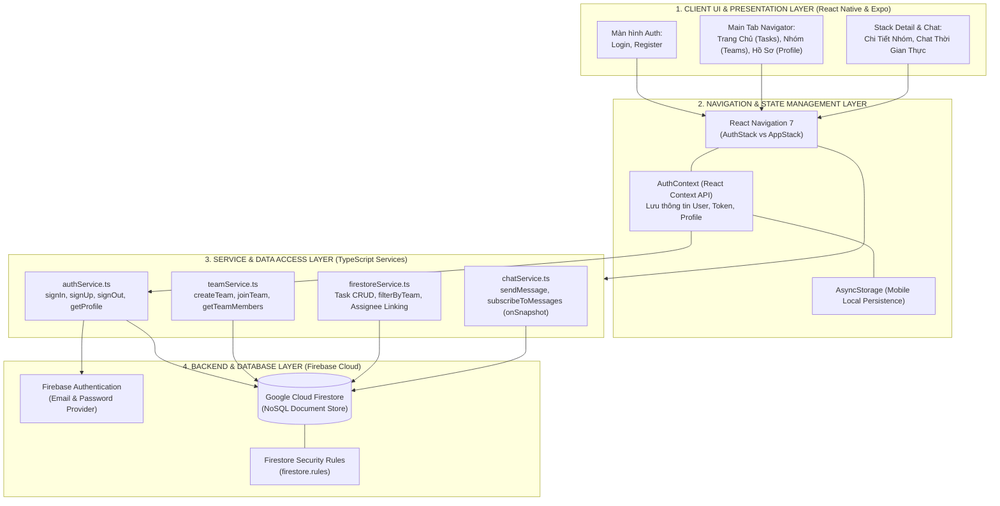
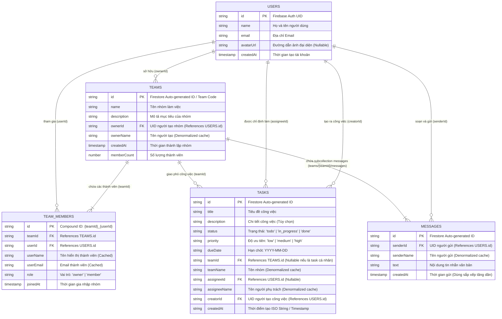

# I. KIẾN TRÚC HỆ THỐNG & FIRESTORE DATA SCHEMA (ERD)

> **Dự án**: TaskAura PRO – Hệ thống Quản lý Công việc & Hợp tác Đội nhóm Thời gian thực  
> **Môn học**: MMA301 – Lập trình Di động (React Native & Firebase)  
> **Nền tảng**: Expo SDK 57 (React Native 0.86, React 19, TypeScript)  
> **Backend & Cơ sở dữ liệu**: Firebase Authentication & Google Cloud Firestore  

---

## 1. TỔNG QUAN KIẾN TRÚC HỆ THỐNG (SYSTEM ARCHITECTURE)

Hệ thống được thiết kế theo mô hình **Client-Server kiến trúc Serverless (BaaS - Backend as a Service)**, tối ưu cho ứng dụng di động đa nền tảng (Android & iOS). Mô hình chia làm 4 tầng chính:

### 1.1. Luồng hoạt động & Bảo mật điều hướng (Protected Routing)
- **Tầng Xác thực (Global Auth Listener)**: Sử dụng `onAuthStateChanged` của Firebase Auth kết hợp `React Context` (`AuthContext`).
- **Phân luồng điều hướng (State-driven Navigation)**:
  - Khi chưa đăng nhập (`user === null`): `AppNavigator` chỉ render `AuthStack` (bao gồm `LoginScreen` và `RegisterScreen`). Người dùng không thể truy cập bất kỳ màn hình nào bên trong ứng dụng.
  - Khi đã xác thực thành công (`user !== null`): Điều hướng tự động chuyển sang `AppStack` (bao gồm `MainTabs`, `TeamDetailScreen`, và `TeamChatScreen`).
- **Độ trễ & Giữ phiên (Session Persistence)**: Phiên đăng nhập được Firebase Client SDK và `AsyncStorage` tự động lưu trữ, duy trì trạng thái đăng nhập khi người dùng khởi động lại ứng dụng.
- **Tối ưu kết nối mạng**: Kích hoạt `experimentalForceLongPolling: true` trong cấu hình Firestore giúp kết nối thời gian thực ổn định trên mọi môi trường mạng di động và máy ảo Android.

---

## 2. SƠ ĐỒ THỰC THỂ - LIÊN KẾT FIRESTORE (ERD - ENTITY RELATIONSHIP DIAGRAM)

Cloud Firestore là cơ sở dữ liệu **NoSQL Document-oriented**. Sơ đồ dưới đây biểu diễn cấu trúc các collection, subcollection, khóa chính (Document ID) và các liên kết khóa ngoại (Foreign Key References):

---

## 3. CHI TIẾT CẤU TRÚC DỮ LIỆU CÁC COLLECTION (FIRESTORE DATA SCHEMA)

### 3.1. Collection `users`
- **Mục đích**: Lưu thông tin hồ sơ của người dùng sau khi đăng ký Firebase Authentication.
- **Quy tắc Document ID**: Sử dụng trực tiếp `User.uid` từ Firebase Auth (1-1 mapping).

| Trường (Field) | Kiểu dữ liệu | Bắt buộc | Mô tả |
| :--- | :--- | :---: | :--- |
| `id` | `string` | Có | Firebase Auth UID |
| `name` | `string` | Có | Họ tên đầy đủ của người dùng |
| `email` | `string` | Có | Email đăng ký |
| `avatarUrl` | `string \| null` | Không | URL ảnh đại diện (mặc định `null`) |
| `createdAt` | `timestamp` | Có | Thời điểm tạo tài khoản (`serverTimestamp()`) |

---

### 3.2. Collection `teams`
- **Mục đích**: Quản lý các nhóm làm việc (Projects / Workspaces).
- **Quy tắc Document ID**: Tự động sinh bởi Firestore (Auto-generated Unique ID) và đóng vai trò làm **Mã nhóm (Team Code)** để chia sẻ cho các thành viên khác gia nhập.

| Trường (Field) | Kiểu dữ liệu | Bắt buộc | Mô tả |
| :--- | :--- | :---: | :--- |
| `id` | `string` | Có | ID duy nhất của nhóm (dùng làm mã mời) |
| `name` | `string` | Có | Tên nhóm |
| `description` | `string` | Không | Mô tả mục tiêu, giới thiệu nhóm |
| `ownerId` | `string` | Có | UID của người sáng lập nhóm |
| `ownerName` | `string` | Không | Tên hiển thị của Leader (Denormalized) |
| `createdAt` | `timestamp` | Có | Thời điểm khởi tạo nhóm |
| `memberCount` | `number` | Không | Số lượng thành viên hiện tại trong nhóm |

---

### 3.3. Collection `teamMembers`
- **Mục đích**: Quản lý mối quan hệ nhiều-nhiều (Many-to-Many) giữa người dùng (`users`) và nhóm (`teams`).
- **Quy tắc Document ID**: Sử dụng **Compound Key**: `{teamId}_{userId}`. Cơ chế này ngăn chặn tuyệt đối việc một người dùng bị thêm trùng lặp vào cùng một nhóm.

| Trường (Field) | Kiểu dữ liệu | Bắt buộc | Mô tả |
| :--- | :--- | :---: | :--- |
| `id` | `string` | Có | Khóa kết hợp: `{teamId}_{userId}` |
| `teamId` | `string` | Có | Tham chiếu tới `teams.id` |
| `userId` | `string` | Có | Tham chiếu tới `users.id` |
| `userName` | `string` | Có | Tên thành viên (được lưu cache để load nhanh) |
| `userEmail` | `string` | Có | Email thành viên |
| `role` | `string` | Có | Vai trò trong nhóm: `"owner"` hoặc `"member"` |
| `joinedAt` | `timestamp` | Có | Thời điểm gia nhập nhóm |

---

### 3.4. Collection `tasks`
- **Mục đích**: Lưu trữ toàn bộ các nhiệm vụ cần thực hiện, hỗ trợ phân loại cá nhân hoặc liên kết nhóm và người phụ trách.
- **Quy tắc Document ID**: Tự động sinh bởi Firestore.

| Trường (Field) | Kiểu dữ liệu | Bắt buộc | Mô tả |
| :--- | :--- | :---: | :--- |
| `id` | `string` | Có | Mã định danh công việc |
| `title` | `string` | Có | Tiêu đề công việc |
| `description` | `string` | Không | Chi tiết nội dung công việc |
| `status` | `string` | Có | Trạng thái: `'todo'` \| `'in_progress'` \| `'done'` |
| `priority` | `string` | Có | Mức độ ưu tiên: `'low'` \| `'medium'` \| `'high'` |
| `dueDate` | `string` | Có | Hạn hoàn thành: định dạng `YYYY-MM-DD` |
| `teamId` | `string \| null` | Không | ID nhóm được gán công việc (hoặc `null` nếu là việc cá nhân) |
| `teamName` | `string \| null` | Không | Tên nhóm hiển thị trên thẻ task |
| `assigneeId` | `string \| null` | Không | UID thành viên được giao việc |
| `assigneeName` | `string \| null` | Không | Tên thành viên được giao việc (hiển thị trực tiếp trên Card) |
| `creatorId` | `string` | Có | UID người khởi tạo công việc |
| `createdAt` | `string \| timestamp`| Có | Thời điểm khởi tạo |

---

### 3.5. Subcollection `teams/{teamId}/messages` (Real-time Team Chat)
- **Mục đích**: Lưu trữ tin nhắn trao đổi nội bộ theo từng nhóm, hỗ trợ stream thời gian thực bằng `onSnapshot`.
- **Đường dẫn phân cấp**: `teams/{teamId}/messages/{messageId}`
- **Quy tắc Document ID**: Tự động sinh bởi Firestore.

| Trường (Field) | Kiểu dữ liệu | Bắt buộc | Mô tả |
| :--- | :--- | :---: | :--- |
| `id` | `string` | Có | ID duy nhất của tin nhắn |
| `senderId` | `string` | Có | UID người gửi tin nhắn |
| `senderName` | `string` | Có | Tên hiển thị người gửi |
| `text` | `string` | Có | Nội dung tin nhắn văn bản |
| `createdAt` | `timestamp` | Có | Thời gian gửi (`serverTimestamp()` - dùng sắp xếp `asc`) |

---

## 4. CHIẾN LƯỢC THIẾT KẾ & TỐI ƯU HÓA (KEY ARCHITECTURAL DECISIONS)

1. **Phi chuẩn hóa dữ liệu có kiểm soát (Denormalization)**:
   - Trong các document `tasks` và `teamMembers`, hệ thống chủ động lưu kèm `userName`, `teamName`, `assigneeName`.
   - **Lợi ích**: Giúp màn hình Trang Chủ và Chi Tiết Nhóm chỉ cần thực hiện 1 truy vấn đơn lẻ để hiển thị đầy đủ thông tin mà không cần thực hiện nhiều câu truy vấn lồng nhau (Join-free read), tiết kiệm chi phí đọc Firestore và tối đa hóa độ mượt 60 FPS trên thiết bị di động.

2. **Cấu trúc Subcollection cho Chat Thời gian thực (`teams/{teamId}/messages`)**:
   - Thay vì tạo collection `messages` phẳng ở tầng root, việc đặt `messages` làm subcollection trực thuộc từng `teamId` mang lại:
     - Giới hạn phạm vi lắng nghe (`onSnapshot`) chỉ nằm trong nhóm hiện tại, không gây quá tải mạng và chi phí Firestore.
     - Dễ dàng quản lý vòng đời dữ liệu (khi xóa nhóm thì truy vấn theo subcollection rất mạch lạc).

3. **Chống trùng lặp thành viên bằng Compound Document ID**:
   - Khóa chính `teamMembers/{teamId}_{userId}` ngăn chặn hoàn toàn lỗi race condition hoặc thao tác bấm đúp nút "Gia nhập nhóm", đảm bảo tính toàn vẹn dữ liệu.

4. **Bảo mật phân quyền toàn diện (Firestore Security Rules)**:
   - Toàn bộ các thao tác Đọc/Ghi (`read`, `write`) đều yêu cầu điều kiện `request.auth != null`, ngăn chặn truy cập trái phép từ bên ngoài khi chưa xác thực.
